# AlphaLemuroid 🚀

[](https://android.com)
[](LICENSE)
[](https://kotlinlang.org)
[](https://retroachievements.org)

**AlphaLemuroid** is an enhanced feature-rich fork of [Lemuroid](https://github.com/Swordfish90/Lemuroid) adding extra features like RetroAchievements Tracking, Advanced Controls Editor, Game Media scraping, Cheats Support, IPS Patching, Full App Backup & Restore, Unlimited Save States, Interactive UI and much more.

---

## 📸 Screenshots

| 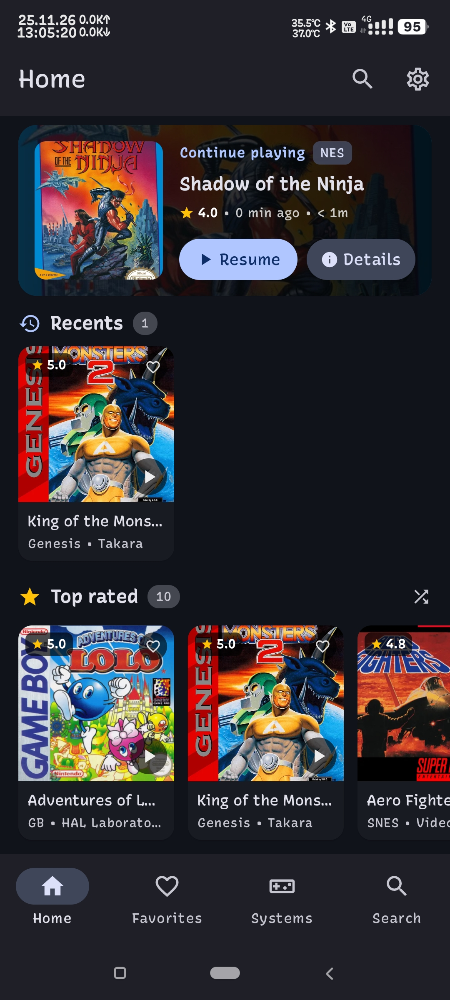 | 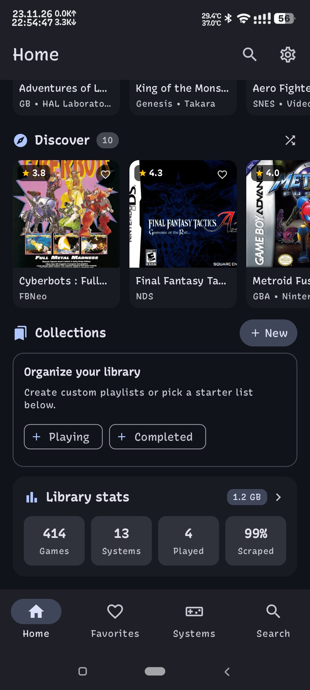 | 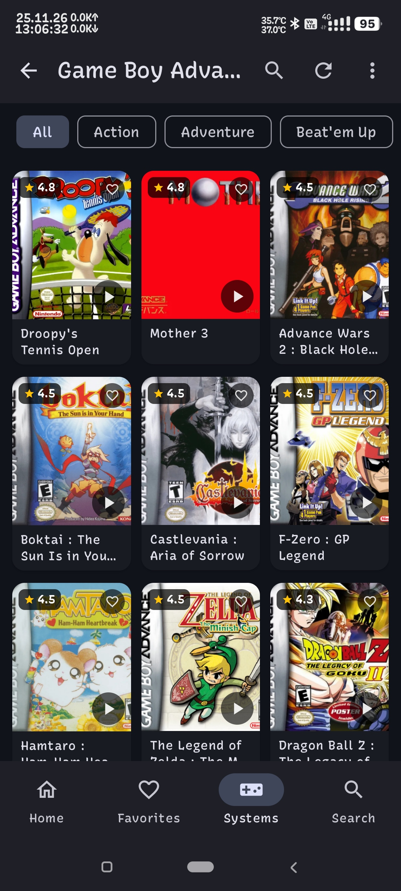 |
|:---:|:---:|:---:|
| **Continue Playing & Home** | **Discover & Collections** | **Grid View & Genre Filters** |

| 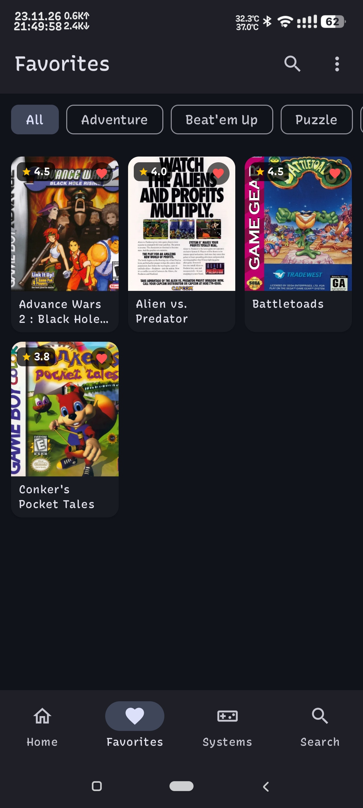 | 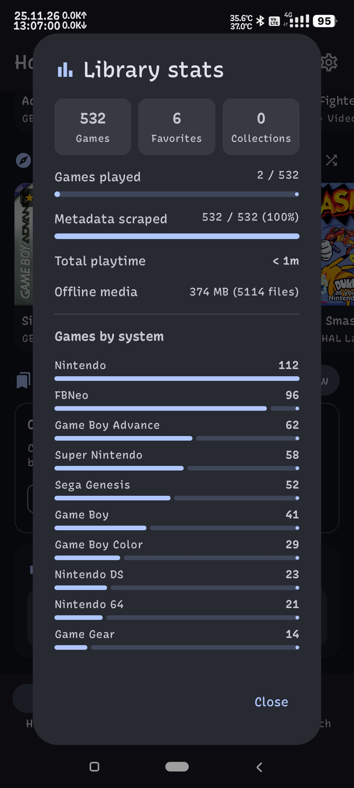 | 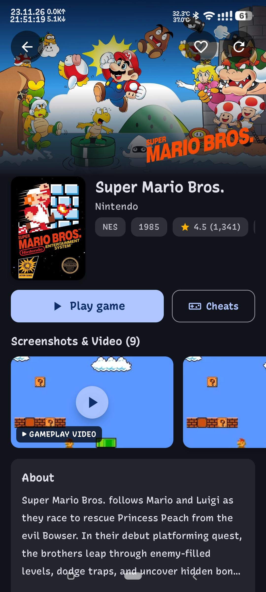 |
|:---:|:---:|:---:|
| **Favorites** | **Library Statistics** | **Game Details & Media** |

| 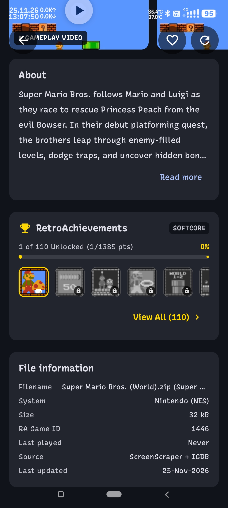 | 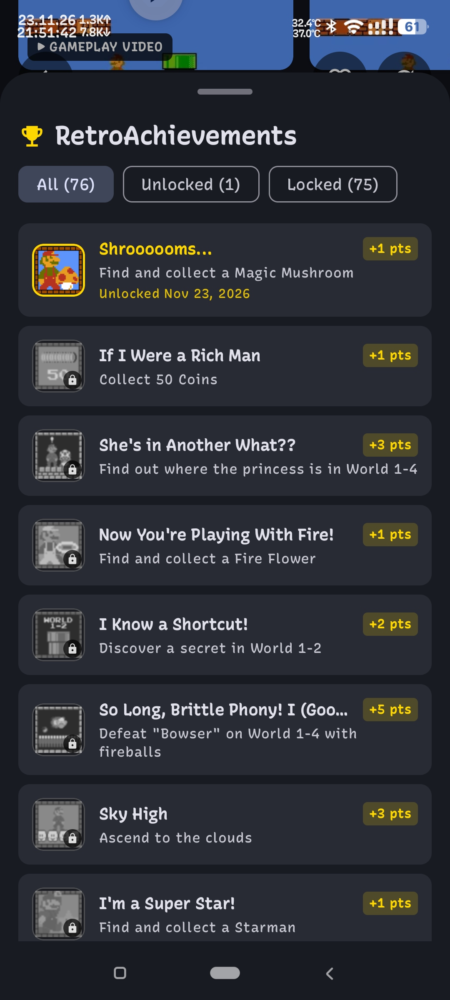 | 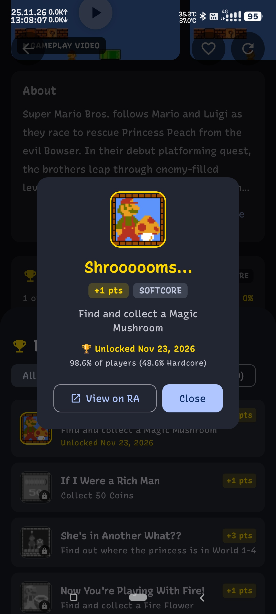 |
|:---:|:---:|:---:|
| **RA Progress & File Info** | **Achievements Sheet** | **Achievement Details** |

| 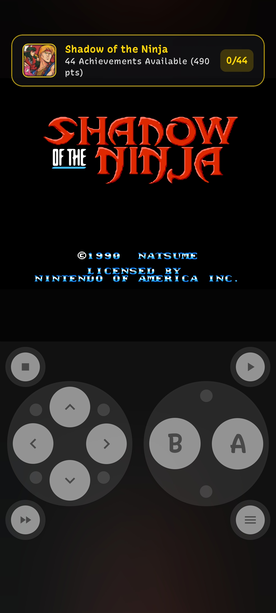 | 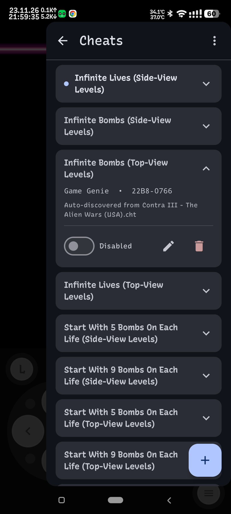 | 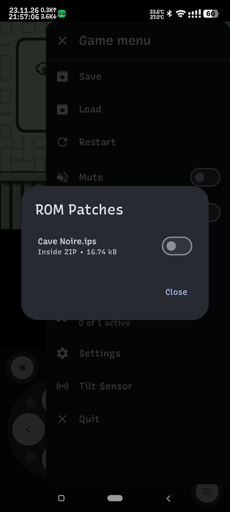 |
|:---:|:---:|:---:|
| **Achievement Unlock Banner** | **Cheat Manager** | **ROM Patches** |

| 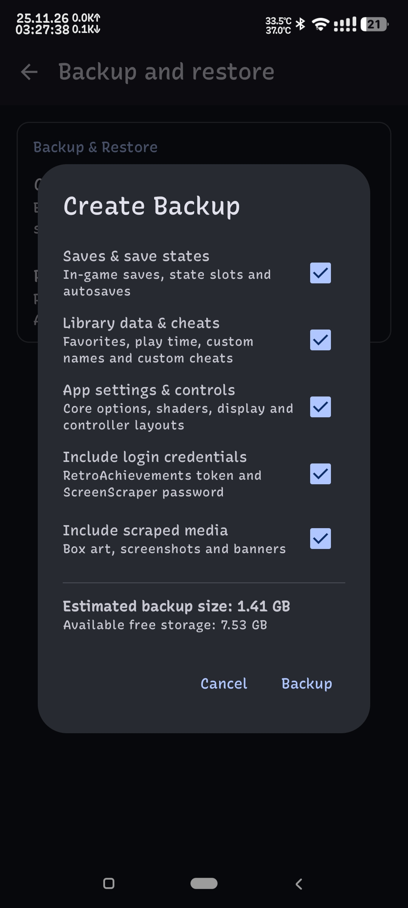 | 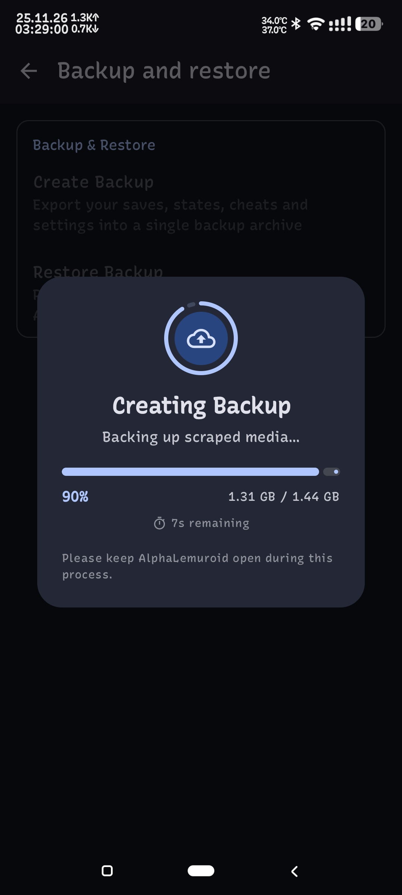 | 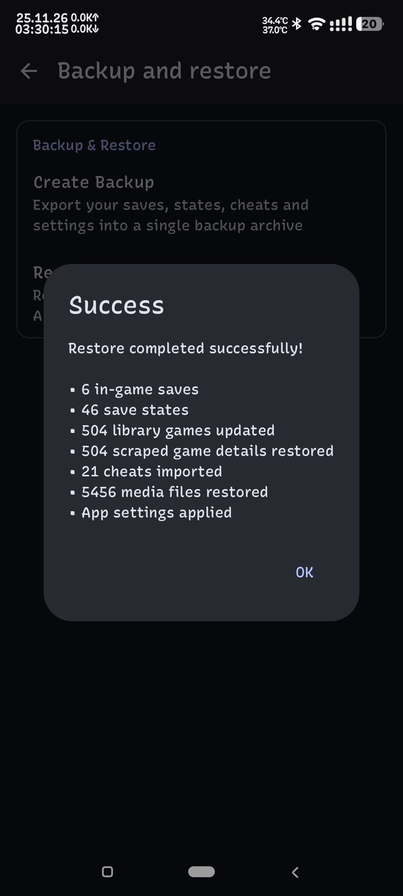 |
|:---:|:---:|:---:|
| **Selective Backup Creation** | **Live Backup Progress** | **Restore Summary** |

| 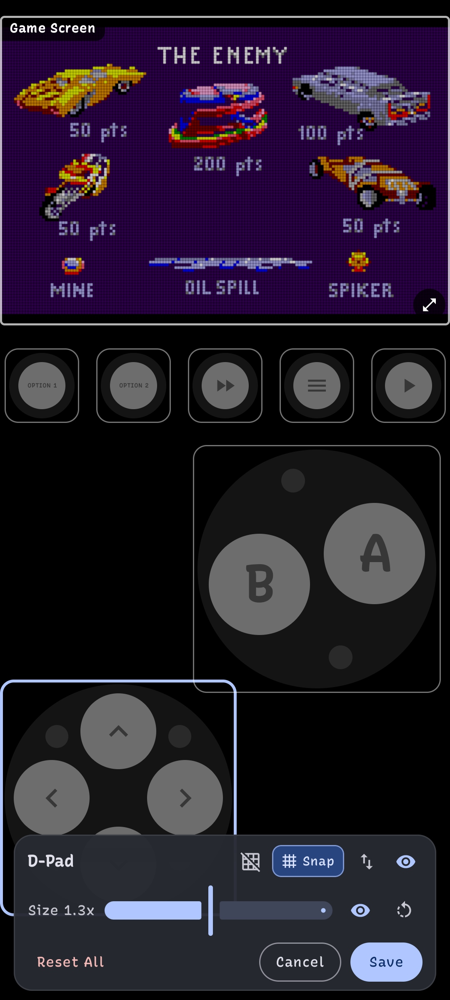 | 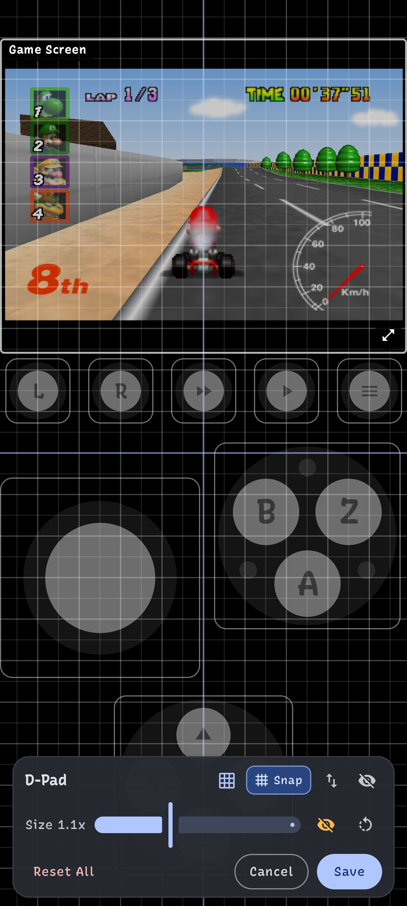 | 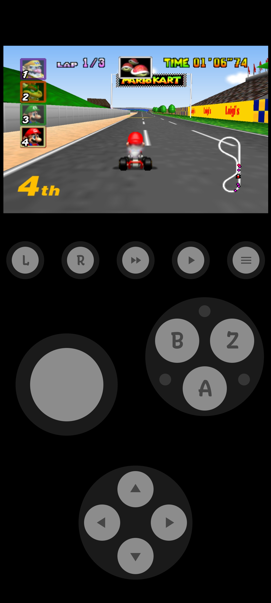 |
|:---:|:---:|:---:|
| **Advanced HUD Editor** | **Grid & Snap Mode** | **Custom HUD Testing** |

---

## 🌟 Key Features & Changelog

### 1. RetroAchievements Tracking Support

* **Native C++ Engine:** Integrated the official `rcheevos` C library directly into our native LibretroDroid core

* **Strict Hardcore Mode Enforcement:**
  * **Save States & Load States:** Fully disabled in the pause menu and hotkeys.
  * **Auto-Save Bypassed:** Auto-save serialization and boot-time state restores are disabled.
  * **Slot Saves Blocked:** Manual slot operations are denied with an on-screen warning toast.
  * **Cheats & Rewind Disabled:** Native cheat injection and rewind buffers are strictly locked out during Hardcore gameplay.

* **Rich UI & Progression:**
  * **Game Details Badge Row:** Horizontal scrolling shelf displaying high-res unlocked and locked badge icons directly from RetroAchievements.
  * **Expandable Bottom Sheet:** Draggable bottom sheet with unlock timestamps, progress indicators and point counters.
  * **Animated In-Game Notification Banner:** Banner displaying badge, achievement title, points and trophy icon upon unlocking an achievement.

---

### 🎨 2. Modern UI Revamp & Home Screen

* **Continue Playing Hero Card:**
  * Large spotlight card on the Home screen for the game you're currently playing.
  * Displays the game cover, system tag, rating, when you last played and total playtime.
  * One-tap Resume to jump straight back into the game or Details to open its info page.

* **Rich Game Info Page:**
  * Dedicated game detail screen with banners, logo wheels, release year, developer/publisher, user ratings and full synopsis.
  * Media gallery to browse screenshots, title screens and watch gameplay videos.
  * File info card displaying disk path, file size, ROM CRC32 checksum, metadata source and total playtime.

* **Custom Collections & Dynamic Shelves:**
  * Create, rename and manage custom collections directly from the Home screen.
  * Top rated shelf featuring a Shuffle button to rotate through your highest-rated titles.
  * Discover shelf to highlight unplayed gems from your library.

* **Library Statistics Overview:**
  * Quick-stats pill on Home showing total games, systems, played count and offline media size.
  * Dialog featuring played/scraped progress bars, total playtime and a sorted games-by-system distribution chart.

---

### 🌐 3. High-Performance Metadata & Offline Media Scraper

* **3 Scraping Modes:**

  * **Mixed (Default):** Queries ScreenScraper and IGDB in parallel and merges missing descriptions, genres, ratings and artwork.
  * **ScreenScraper:** Exclusively uses ScreenScraper metadata and media.
  * **IGDB:** Exclusively uses IGDB metadata and media.

* **Customizable Media Types:**
  * Choose box art style (2D, 3D).
  * Selectively download: Box Art, Hero Banners, Fanarts, Logo Wheels, Gameplay Screenshots, Title Screens and Gameplay Videos.

* **Background Batch Scraping & Dual Notifications:**
  * Scrape individual systems or entire libraries in the background via WorkManager.

* **Offline Media Storage Manager:**
  * Local Recalbox-style directory structure (`<externalFilesDir>/media/<system>/<type>/`).
  * Interactive Media storage settings screen with collapsible per-system dropdowns to view and delete specific media categories individually.

---

### 🎮 4. System Games, Favorites & Search

* **Grid View & List View:**
  * Switch between a modern 3-column grid and classic list view via the 3-dot menu (`⋮`).

* **Multi-Select Genre Filtering:**
  * Multi-select genre tags in Games and Favorites to easily filter your library.

* **Deep Metadata Search:**
  * Search your library by game titles, filenames, developer name, publisher, genres, release year, synopsis and ROM CRC32 hash.

* **Sort Options:**
  * Sort by Name (A–Z / Z–A), Recently Played, Most Played, Highest Rated, Most Rated (highest user rating count) or Release Date.

---

### 📁 5. Multi-Folder ROM Storage

* **Multiple Storage Directories:**
  * Add multiple independent ROM directories across internal storage and external SD cards.

---

### 📦 6. Complete App Backup & Restore

* **One-Click Full & Selective Backup:**
  * Create portable .zip backup archives containing any combination of your data:
    * **Game Saves (`.srm`):** In-game battery/memory card saves.
    * **Save States (`.slot*` & metadata):** Full state dumps, custom titles and screenshot preview thumbnails.
    * **Scraped Offline Media:** Box arts, hero banners, fanarts, logo wheels, screenshots, title screens and gameplay videos.
    * **Cheats (`.cht`):** Discovered, imported and custom cheat codes.
    * **Custom Collections:** User-created collections and playlist entries.
    * **Game Database & Metadata:** Cache of scraped titles, genres, ratings, developer info and play statistics.
    * **Application Settings:** Core configurations, touch controller and custom HUD layouts, and app preferences.

---

### 🎛️ 7. Advanced HUD & Touch Controls Editor

* **Move, Resize & Hide Buttons:** Drag individual buttons and sticks anywhere on screen, resize them (`0.5x`–`2.2x`) or hide ones you don't need.
* **Movable & Resizable Game Screen:** Move the game screen anywhere you want and resize it by dragging the corner or using the Width/Height sliders.
* **Alignment Grid & Snap / Free Move:** Turn on the grid to line controls up evenly across the center line and toggle between Snap and Free move right from the toolbar.
* **Easy Reset & Backups:** Reset a single control or the whole layout anytime with full Backup & Restore support.

---

### ⚡ 8. Cheats, IPS Patching, Save States & Gameplay Tweaks

* **In-Game HUD Fast-Forward Button:**
  * Dedicated on-screen HUD button (`⏩`) for instant fast-forward toggling.
  * Single Tap: Instantly toggles Fast-Forward ON / OFF.
  * Long-Press: Opens the fast-forward speed selector dialog.
  * Configure default speed globally under **Settings → General → Fast-forward speed**.

* **Unlimited Save States & State Management:**
  * Replaced the fixed 4-slot limitation with support for unlimited dynamic save state slots.
  * Custom state naming: Rename save states with descriptive titles directly from the menu.
  * Delete individual save states and thumbnails with instant list refresh.
  * Clean Material 3 context menu accessible via the 3-dots button (`⋮`) or by long-pressing any state card.

* **Native Cheat Support & Automatic .cht Detection:**
  * Built-in cheat injection for NES, SNES, Game Boy, Game Boy Color and Game Boy Advance.
  * Automatically detects `.cht` cheat files in your ROM folder (e.g. `GameName.cht` for `GameName.zip`) as well as any `.cht` files inside `.zip` archives.
  * Import and export standard `.cht` files with live preview before applying.

* **In-Game IPS ROM Patching:**
  * Built-in IPS patch engine that applies ROM hacks directly in memory without altering your original ROM file.
  * Automatically detects `.ips` patch files in your ROM folder (e.g. `GameName.ips` for `GameName.zip`) as well as any `.ips` files inside `.zip` archives.
  * Manage active patches via the pause menu with instant reload support.

* **Playtime Tracking:**
  * Automatically records total playtime per game across sessions.

---

## 🕹️ Supported Systems & ROM Folders

If you organize ROMs by folder, name each folder using the Folder column below. Cartridge ROMs can usually be detected automatically, while Arcade & Disc games files need their matching folder name to scan properly.

| System | Folder | Extensions | Core |
|---|---|---|---|
| **Nintendo Entertainment System (NES)** | `nes` | `.nes`, `.zip` | [fceumm](https://docs.libretro.com/library/fceumm/) |
| **Super Nintendo (SNES)** | `snes` | `.sfc`, `.smc`, `.zip` | [snes9x](https://docs.libretro.com/library/snes9x/) |
| **Game Boy (GB)** | `gb` | `.gb`, `.zip` | [gambatte](https://docs.libretro.com/library/gambatte/) |
| **Game Boy Color (GBC)** | `gbc` | `.gbc`, `.zip` | [gambatte](https://docs.libretro.com/library/gambatte/) |
| **Game Boy Advance (GBA)** | `gba` | `.gba`, `.zip` | [mgba](https://docs.libretro.com/library/mgba/) |
| **Nintendo 64 (N64)** | `n64` | `.n64`, `.z64`, `.zip` | [mupen64plus](https://docs.libretro.com/library/mupen64plus/) |
| **Nintendo DS (NDS)** | `nds` | `.nds`, `.zip` | [desmume](https://docs.libretro.com/library/desmume/) / [melonDS](https://docs.libretro.com/library/melonds/) |
| **Nintendo 3DS (3DS)** | `3ds` | `.3ds`, `.zip` | [citra](https://docs.libretro.com/library/citra/) |
| **Sega Genesis / Mega Drive** | `md` | `.gen`, `.smd`, `.md`, `.zip` | [genesis_plus_gx](https://docs.libretro.com/library/genesis_plus_gx/) |
| **Sega Master System (SMS)** | `sms` | `.sms`, `.zip` | [genesis_plus_gx](https://docs.libretro.com/library/genesis_plus_gx/) |
| **Sega Game Gear (GG)** | `gg` | `.gg`, `.zip` | [genesis_plus_gx](https://docs.libretro.com/library/genesis_plus_gx/) |
| **Sega CD (SCD)** | `scd` | `.cue`, `.iso`, `.chd` | [genesis_plus_gx](https://docs.libretro.com/library/genesis_plus_gx/) |
| **Sony PlayStation (PSX)** | `psx` | `.chd`, `.pbp`, `.cue`, `.iso`, `.m3u` | [PCSX-ReARMed](https://docs.libretro.com/library/pcsx_rearmed/) |
| **Sony PlayStation Portable (PSP)** | `psp` | `.iso`, `.cso`, `.pbp` | [ppsspp](https://docs.libretro.com/library/ppsspp/) |
| **Arcade (FBNeo)** | `fbneo` | `.zip` | [fbneo](https://github.com/libretro/FBNeo/) |
| **Arcade (MAME 2003-Plus)** | `mame2003plus` | `.zip` | [mame2003_plus](https://docs.libretro.com/library/mame2003_plus/) |
| **Atari 2600** | `atari2600` | `.a26`, `.zip` | [stella](https://docs.libretro.com/library/stella/) |
| **Atari 7800** | `atari7800` | `.a78`, `.bin`, `.zip` | [prosystem](https://docs.libretro.com/library/prosystem/) |
| **Atari Lynx** | `lynx` | `.lnx`, `.zip` | [handy](https://docs.libretro.com/library/handy/) |
| **PC Engine / TurboGrafx-16** | `pce` | `.pce`, `.bin`, `.zip` | [beetle_pce_fast](https://docs.libretro.com/library/beetle_pce_fast/) |
| **Neo Geo Pocket / Color** | `ngp` / `ngc` | `.ngp`, `.ngc`, `.zip` | [mednafen_ngp](https://docs.libretro.com/library/beetle_neopop/) |
| **WonderSwan / Color** | `ws` / `wsc` | `.ws`, `.wsc`, `.zip` | [beetle_cygne](https://docs.libretro.com/library/beetle_cygne/) |
| **MS-DOS** | `dos` | `.dosz` | [dosbox_pure](https://docs.libretro.com/library/dosbox_pure/) |

---

## 🛠️ Building from Source

### Prerequisites
* Android Studio Ladybug | 2024.2.1 or newer
* Android SDK (API Level 34) & NDK (26.1.10909125)
* JDK 17

### Build Commands
Clone the repository with submodules:
```bash
git clone --recurse-submodules https://github.com/BetterCallShiv/Lemuroid.git
cd Lemuroid
```

Build the debug APK:
```bash
./gradlew :lemuroid-app:assembleAlphaFreeDynamicDebug
```

Build the release APK:
```bash
./gradlew :lemuroid-app:assembleAlphaFreeBundleRelease
```

---

## 🤝 Acknowledgements & Credits

* **[Swordfish90](https://github.com/Swordfish90)** for the original [Lemuroid](https://github.com/Swordfish90/Lemuroid) and [LibretroDroid](https://github.com/Swordfish90/LibretroDroid) projects.
* **[RetroAchievements](https://retroachievements.org)** and the `rcheevos` team for their C library.
* **[Libretro](https://www.libretro.com/)** and core maintainers for cross-platform emulation backends.
* **[Hasheous](https://hasheous.org/)**, **[ScreenScraper](https://www.screenscraper.fr/)** and **[IGDB](https://www.igdb.com/)** for ROM identification, metadata and media assets.
